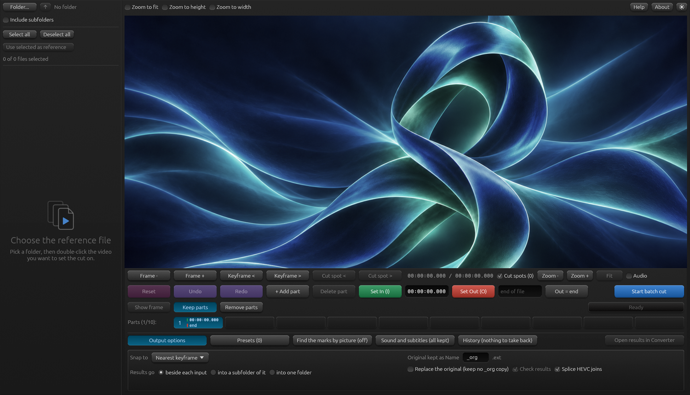

# Batch Cutter 0.95

**A lossless batch video cutter for Windows and Linux.** Mark the cut in one reference file - with the picture, the stereo sound wave, mouse-wheel zoom and playback - and every checked file of the folder is cut at the same point. Nothing is decoded or re-encoded: every cut starts on a real keyframe of that file. Built for removing commercials from recordings.

**[Download Batch Cutter 0.95](https://github.com/WaveboSF/Batch-Cutter/releases/tag/v0.95)**

*Batch Cutter 0.95 on Linux - the empty window at the start.*

| Platform | Download | Checksum |
|---|---|---|
| Windows 10/11, x64 | [Zip](https://github.com/WaveboSF/Batch-Cutter/releases/download/v0.95/Batch-Cutter-0.95-windows-x64.zip) | [SHA-256](https://github.com/WaveboSF/Batch-Cutter/releases/download/v0.95/Batch-Cutter-0.95-windows-x64.zip.sha256) |
| Linux, x86-64, glibc 2.43+ | [Archive](https://github.com/WaveboSF/Batch-Cutter/releases/download/v0.95/Batch-Cutter-0.95-linux-x86_64.tar.gz) | [SHA-256](https://github.com/WaveboSF/Batch-Cutter/releases/download/v0.95/Batch-Cutter-0.95-linux-x86_64.tar.gz.sha256) |

Each download is one program file plus an optional install script for the current user, the icon and the licence notices.

## What it does

- Choose one file as the reference, set the cut on it, and every checked file of the folder is cut at the same point; the result takes the original's name and the original is kept as `A_org.mkv`.
- Several parts per file can be kept or removed; marks can be found by picture; sound tracks and subtitles can be left out; a run can be taken back.
- Lossless: no re-encoding, so a cut is as fast as a copy.

## Requirements

`ffmpeg`, `ffprobe` and `ffplay` (8.x tested) in `PATH` or next to the program. Linux needs glibc 2.43 or newer (Ubuntu 26.04 or newer). The Windows file is not code-signed, so SmartScreen may warn on first start. No macOS build is published.

## Together with FFmpeg CC GUI

Batch Cutter is the companion of **[FFmpeg CC GUI](https://github.com/WaveboSF/FFmpeg-CC-GUI/releases/tag/v0.95)**, the ffmpeg converter from the same author: its **Batch Cutter** button starts the cutter on the Batch Folder or the Input File, and the cutter can hand its results back to the converter.

## Contributors

Batch Cutter is built and maintained by [S.F. / WaveboSF](https://github.com/WaveboSF),
with plenty of help from **Anthropic Claude** and [**OpenAI Codex**](https://github.com/codex).
These advanced coding tools are part of the daily toolbox—from turning ideas
into code to tracking down stubborn bugs, testing and writing the docs. The
maintainer sets the direction, decides what ships—and occasionally says,
“No, that’s not what I meant,” because otherwise the cutter would proudly remove the good parts and keep the commercials.

Three of us made this one: S.F. (direction and decisions), Claude from Anthropic and Codex from OpenAI.

The public repository contains downloads, documentation and notices; the application source remains private. MIT licence (`LICENSE`); the licences of the built-in libraries are listed in `LICENSES/THIRD-PARTY-CRATES.txt`.
