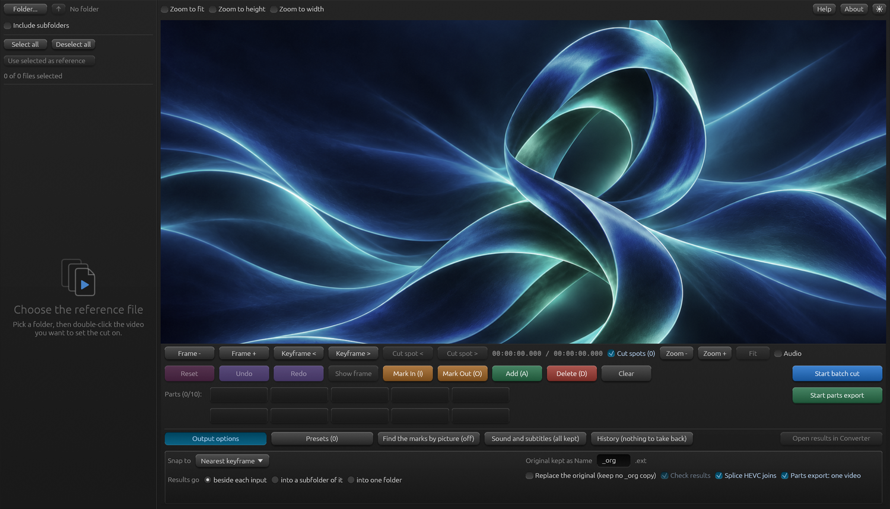

# Batch Cutter 0.98

**A lossless batch video cutter for Windows and Linux.** Mark a stretch in one reference file - with the picture, the stereo sound wave, mouse-wheel zoom and playback - cut it out or copy it into a row of parts, and every checked file of the folder is cut the same way. Nothing is decoded or re-encoded: every cut starts on a real keyframe of that file. Built for removing commercials from recordings - and for putting scenes together in an order of your own.

**[Download Batch Cutter 0.98](https://github.com/WaveboSF/Batch-Cutter/releases/tag/v0.98)**

*Batch Cutter 0.98 on Linux - the empty window at the start.*

| Platform | Download | Checksum |
|---|---|---|
| Windows 10/11, x64 | [Zip](https://github.com/WaveboSF/Batch-Cutter/releases/download/v0.98/Batch-Cutter-0.98-windows-x64.zip) | [SHA-256](https://github.com/WaveboSF/Batch-Cutter/releases/download/v0.98/Batch-Cutter-0.98-windows-x64.zip.sha256) |
| Linux, x86-64, glibc 2.43+ | [Archive](https://github.com/WaveboSF/Batch-Cutter/releases/download/v0.98/Batch-Cutter-0.98-linux-x86_64.tar.gz) | [SHA-256](https://github.com/WaveboSF/Batch-Cutter/releases/download/v0.98/Batch-Cutter-0.98-linux-x86_64.tar.gz.sha256) |

Each download is one program file plus an optional install script for the current user, the icon and the licence notices.

## What it does

- Choose one file as the reference and mark a stretch on it. **Delete (D)** cuts it out - the gap closes, the timeline always shows the result - and **Add (A)** copies it into the row of the parts. **Start batch cut** writes every checked file the same way; the result takes the original's name and the original is kept as `A_org.mkv`.
- **Start parts export** writes the green parts of the row in the order you put them in - as one video (`A_parts.mkv`) or each as a file of its own.
- A part can be put into the video again at another place, also several times; marks can be found by picture; sound tracks and subtitles can be left out; a run can be taken back.
- Lossless: no re-encoding, so a cut is as fast as a copy.

## New in 0.98

- **Delete (D) really cuts out, Add (A) copies.** What is cut out leaves the timeline and the gap closes; a red line marks the cut, and the stretch stands in the row of the parts in red. Add puts a green copy there and leaves the video as it is.
- **The row of the parts:** a click chooses a part and Space plays it, a double click selects it for the export, a drag puts it at another place of the row. The right button puts a part into the video again (at the playhead, at a cut, several times), puts it back where it was, or turns red into green and green into red.
- **Start parts export** writes the selected green parts in the order of the row - one video or one file each. Beside each input the row stays after Start batch cut, and the parts are read from the kept original.
- **Playing over a cut** shows what the result will have there; Shift+K plays around a cut; a click on the picture plays and stops.
- **The right button on the timeline** opens a menu of what it hit - what is marked, a cut, a marker or the ground.
- **M switches the sound** (the marker key is N now); Del and Ins do what D and A do.
- A cleaner window: Mark In and Mark Out side by side, no line of text between the buttons and the parts; what is rounded to keyframes stands behind ".ext" in Output options, what is to be said over the picture for a few seconds.
- Presets saved with 0.95 to 0.97 are read.

## Requirements

`ffmpeg`, `ffprobe` and `ffplay` (8.x tested) in `PATH` or next to the program. Linux needs glibc 2.43 or newer (Ubuntu 26.04 or newer). The Windows file is not code-signed, so SmartScreen may warn on first start. No macOS build is published.

## Together with FFmpeg CC GUI

Batch Cutter is the companion of **[FFmpeg CC GUI](https://github.com/WaveboSF/FFmpeg-CC-GUI/releases/latest)**, the ffmpeg converter from the same author: its **Batch Cutter** button starts the cutter on the Batch Folder or the Input File, and the cutter can hand its results back to the converter.

## Contributors

Batch Cutter is built and maintained by [S.F. / WaveboSF](https://github.com/WaveboSF),
with plenty of help from **Anthropic Claude** and [**OpenAI Codex**](https://github.com/codex).
These advanced coding tools are part of the daily toolbox—from turning ideas
into code to tracking down stubborn bugs, testing and writing the docs. The
maintainer sets the direction, decides what ships—and occasionally says,
“No, that’s not what I meant,” because otherwise the cutter would proudly remove the good parts and keep the commercials.

Three of us made this one: S.F. (direction and decisions), Claude from Anthropic and Codex from OpenAI.

The public repository contains downloads, documentation and notices; the application source remains private. MIT licence (`LICENSE`); the licences of the built-in libraries are listed in `LICENSES/THIRD-PARTY-CRATES.txt`.
